# swosgfx

Graphics and palettes for **Sensible World of Soccer** — Amiga, PC (DOS) and Atari
Jaguar: extract them, convert between the formats, and put edited art back. A command-line
tool for Windows, macOS and Linux, and a plain C99 library under it.

swosgfx is the C/C++ rewrite of the C# [SwosGfx](https://github.com/benbaker76/SwosGfx-CSharp):
the same switches, and, for every mode, byte-for-byte the files the C# version writes (each
module was checked against it). The library is what [OpenSWOS](https://github.com/benbaker76/OpenSWOS)'s
data setup uses to build its game data from the player's own copy of SWOS.

**No game data is included.** You need your own copy of the game: point swosgfx at the PC
game's folder (`-dos-dir`), the Amiga files (`-amiga-dir`) or the Jaguar cartridge
(`-jag-rom`). The celebration frames in `assets/jag/` and `assets/glyphs.txt` are this
project's own drawings.

### Screenshots

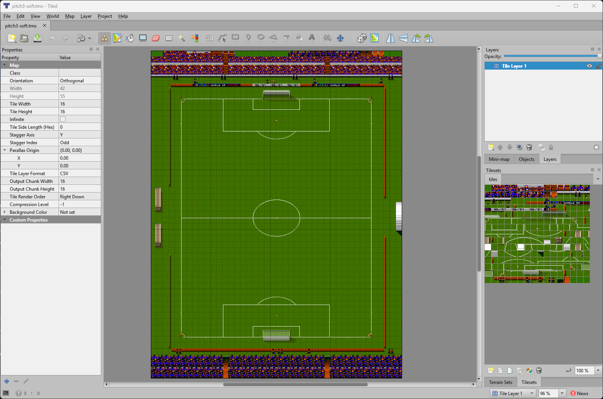

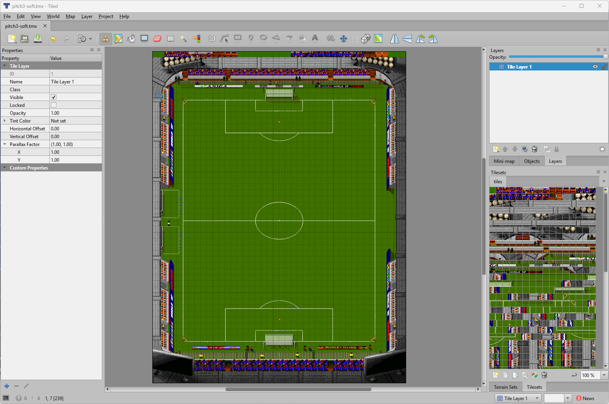

## Download

Executables for Windows (x64), macOS (universal) and Linux (x64, arm64) are built by GitHub
Actions on every push; tagged versions are on the [Releases](https://github.com/benbaker76/swosgfx/releases)
page. Each archive holds `swosgfx`, this README and `assets/`.

## Building

CMake 3.16+ and a C99 / C++17 compiler (GCC, Clang or MSVC); no other dependencies.

```bash
cmake -B build -DCMAKE_BUILD_TYPE=Release
cmake --build build --config Release
# with the tests:
cmake -B build -DSWOSGFX_TESTS=ON && cmake --build build && ctest --test-dir build
```

On Windows the result is one self-contained `swosgfx.exe` (the C runtime is linked in).
The tests run on their own data, and skip what needs the game's files; given the game's
folders as arguments they compare against those too (each test's header says how).

## The library

`lib/` is C99 with fixed-width types and no dependencies, so it builds into any C or C++
program (`add_subdirectory` it and link `swosgfx_lib`). Each mode of the tool is one call:
`Sg_DosSpritesExport`, `Sg_Dos2AmigaRun`, `Sg_Jag2AmigaRun`, `Sg_PalettesExport`, ... — and
the pieces under them are public too: RNC ProPack packing and unpacking (`rnc_pack.h`,
`sg_util.h`), the PC sprite codec (`dos_sprite.h`), Amiga planar pictures (`amiga_raw.h`),
the Amiga image-command scripts (`amiga_scripts.h`), Tiled maps (`tiled_map.h`), the palettes
(`amiga_palette.h`, `dos_palette.h`, `pal_file.h`), the Jaguar cartridge (`jag2amiga.h`). Every
function returns 0 on success, or -1 with the reason in a 256-byte `err` buffer.

## Differences from the C# version

* A relative `-dos-dir`, `-amiga-dir` or `-jag-dir` is looked for in the current folder first,
  then beside the program (the C# looked only beside itself).
* `-dos -picture -output=bmp` with no files converts every `.256` in the DOS folder (the C#
  had the code, but its option check never let it run).
* `-jag2amiga` makes the three `CJCBENCH_PATCH_*` crops (the white-shirted manager, the
  substitute arrow) itself from the game's own art, so they are not files any more; a file of
  that name in the Jaguar folder still overrides its crop.
* File names are matched in any case on every system, as on Windows.
* Damaged input files fail with a message rather than an exception.

---

## Amiga usage

### Explicit input/output (two positional args)

```bash
swosgfx -amiga -map -output=bmp  [-palette=<name>] [-bitplanes=N] [-no-rnc] in.map out.bmp
swosgfx -amiga -map -output=tmj  [-palette=<name>] [-bitplanes=N] [-no-rnc] in.map out.tmj
swosgfx -amiga -tmj -output=map  [-bitplanes=N]    [-no-rnc]      in.tmj out.map
swosgfx -amiga -bmp -output=map  [-bitplanes=N]    [-no-rnc]      fullPitch.bmp out.map
swosgfx -amiga -bmp -output=raw  [-palette=<name>] [-bitplanes=N] [-no-rnc] in.bmp out.raw
swosgfx -amiga -raw -output=bmp  [-palette=<name>] [-bitplanes=N] [-no-rnc] in.raw out.bmp
````

### Batch mode (0 or 1 positional arg)

In batch mode, input comes from the Amiga directory (`./Amiga` by default, or `-amiga-dir=<path>`).

* **0 args**: output goes to the current directory
* **1 arg**: treated as an output directory

Supported batch conversions:

```bash
swosgfx -amiga -raw -output=bmp  [-palette=<name>] [-bitplanes=N] [-no-rnc] [outDir]
swosgfx -amiga -map -output=bmp  [-palette=<name>] [-bitplanes=N] [-no-rnc] [outDir]
swosgfx -amiga -map -output=tmj  [-palette=<name>] [-bitplanes=N] [-no-rnc] [outDir]
```

---

## DOS usage

### DOS pitch rendering (patterns from `./DOS`)

In DOS pitch mode, input is implicit from the DOS directory (`./DOS` by default, or `-dos-dir=<path>`).

This mode renders **all 6 pitches** (`pitch1..pitch6`) using the selected type.

* **0 args**: output goes to the current directory
* **1 arg**: treated as an output directory

```bash
swosgfx -dos -output=bmp [-pitch=N] [-type=normal] [-colors=N] [outDir]
swosgfx -dos -output=tmj [-pitch=N] [-type=normal] [-colors=N] [-insertblanktile] [-tilesetwidth=N] [outDir]
```

Output filenames:

* BMP: `pitchN-<type>.bmp`
* Tiled: `pitchN-<type>.tmj` plus `pitchN-<type>.bmp`, its 8bpp tileset image

Where `<type>` is one of: `frozen, muddy, wet, soft, normal, dry, hard`.

Note: `-pitch` currently exists as an option, but the current implementation renders pitches `1..6` in a loop.

#### Tiled (`.tmj`) export

A pitch is a 42x55 grid of 16x16 patterns, so `-output=tmj` writes the real tile map
rather than a flattened picture: one tile layer plus a tileset image with the unique
tiles. Maps are written in [Tiled's JSON map format](https://doc.mapeditor.org/en/stable/reference/json-map-format/)
(`.tmj`) - one orthogonal tile layer, one embedded tileset with an external image, and
the tile data as a plain array of GIDs. `-output=json` and `-output=tmx` are accepted as
aliases and produce the same `.tmj` file.

On input the format is detected from the file content rather than its extension, so the
XML `.tmx` maps SwosGfx wrote before the switch still load (`-tmj`, `-json` and `-tmx`
are all the same input switch).

Patterns are deduplicated on pixel content, and the switches match the ones
[Tiled2Bin](https://github.com/benbaker76/Tiled2Bin) uses for its `-slice` mode:

| Option              | Description                                                                                                   | Default |
| ------------------- | ------------------------------------------------------------------------------------------------------------- | ------- |
| `-insertblanktile`  | Reserve tile id 0 for an all-transparent tile, so the map never contains gid 0 ("no tile").                    | `false` |
| `-tilesetwidth=<n>` | Tileset image width in pixels (must be a multiple of 16). `256` gives the usual 16 tiles across.               | `256`   |

Rendered with `-insertblanktile`, the maps round-trip: feeding one back
through `-amiga -tmj -output=map` reproduces the pitch pixel for pixel.

---

### DOS picture usage (`.256` → BMP)

```bash
swosgfx -dos -picture -output=bmp in.256 out.bmp
```

---

### DOS sprite usage (SPRITE.DAT + *.DAT from `./DOS`)

#### Export all sprites to BMP

* **0 args**: output to current directory
* **1 arg**: treated as output directory

```bash
swosgfx -dos -sprites-export [-sprite-bg=N] [-output=bmp] [outDir]
# writes sprNNNN.bmp, 0 <= N < 1334
```

#### Import sprites from a directory and update DAT/SPRITE.DAT

```bash
swosgfx -dos -sprites-import spritesDir
# reads sprNNNN.bmp, inserts and saves changes to DAT/SPRITE.DAT
```

---

### DOS → Amiga bank conversion (`-dos2amiga`)

Rebuilds the Amiga sprite / menu / charset banks from the **DOS** graphics: each DOS
sprite is placed at the exact position the original Amiga bank uses (read from the SWOS
image-command scripts), and the result is written as an 8bpp indexed BMP using the DOS
palette. This is the inverse of how the game extracts sprites from a bank.

```bash
swosgfx -dos -dos2amiga [outDir]
```

Produces 11 banks:

* **Gameplay** (Game palette): `CJCGRAFS`, `CJCTEAM1`, `CJCTEAM2`, `CJCTEAM3`, `CJCTEAMG`, `CJCBITS`, `SOCCER_S`, `CJCBENCH`
* **Menu / charset** (Menu palette): `CHARSET`, `MENUS`, `MENUS2`

DOS sprite indices map to Amiga indices as `Amiga = DOS − 114` for gameplay sprites
(DOS index ≥ 227) and 1:1 for the menu / charset sprites. `CJCTEAM1/2/3` share one
layout, sourced from `TEAM1/TEAM2/TEAM3.DAT` respectively; `SOCCER_S` (the big R/S
rotation) uses palette slots `0x70..0x7F`. Full-screen images with no DOS equivalent
(`LOADER*`, `DISK22`, `OLDDISK1`, `MENUBG*`, `RAINBOW`) are not produced by this mode.

---

### Jaguar → Amiga bank conversion (`-jag2amiga`)

The Atari Jaguar release (*Sensible Soccer International Edition*, 1995) ships its
in-game artwork as nine LZ-packed `*.lzj` blobs, each unpacking to exactly 81920 bytes =
one 320x256 8bpp sheet. Six of those sheets are the gameplay sprite banks, laid out at
the **same pixel coordinates** the Amiga image-command scripts read from - the Jaguar
port kept the Amiga bank layout and simply redrew the art at 256 colours.

So this is `-dos2amiga` with a different pixel source: the same scripts are walked, but
each placement is lifted straight out of the matching Jaguar sheet. swosgfx reads the
cartridge itself (it has its own `lz-bits` depacker and CRY colour conversion), so no
external tooling is needed.

```bash
swosgfx -dos -jag2amiga [-jag-rom=<path>] [-jag-dir=<path>] [outDir]
```

With no `-jag-rom`, the first `*.jag` / `*.j64` / `*.rom` / `*.bin` in `./Jag` is used.
The DOS directory is still required - it supplies everything the Jaguar release lacks.

| Amiga bank                          | Jaguar stream | Source                                                     |
| ----------------------------------- | ------------- | ---------------------------------------------------------- |
| `CJCGRAFS`                          | `$8947C0`     | Jaguar scoreboard font + clock captions only, rest from DOS |
| `CJCTEAM1`                          | `$8AC828`     | Jaguar (303 / 303 with the celebration art)                 |
| `CJCTEAM2`                          | `$8AFB58`     | Jaguar (303 / 303)                                          |
| `CJCTEAM3`                          | `$8B2FE0`     | Jaguar (303 / 303)                                          |
| `CJCTEAMG`                          | `$8A02E8`     | Jaguar (232 / 232 - exact)                                  |
| `CJCBITS`                           | `$8993D8`     | Jaguar (24 / 30)                                            |
| `CJCBENCH`                          | `$89D0B0`     | Jaguar (58 / 61)                                            |
| `SOCCER_S`, `CHARSET`, `MENUS`, `MENUS2` | -        | DOS - the Jaguar has its own menu system                    |

Anything the Jaguar sheets do not hold falls back to the DOS sprite, so the output is a
complete drop-in set.

#### Celebration frames

The one gap in the Jaguar artwork is the goal **celebration** - Amiga sprites `251-256`,
`352-357` and `453-458`, which all point at the same six cells at `(144,64)`-`(176,80)`.
That whole 48x32 block is blank in all three Jaguar team sheets, because the Jaguar game
has no celebration. It is supplied by hand-drawn Jaguar-style art (ours ship in
`assets/jag/`; pass `-jag-dir=assets/jag`, or copy them into your `./Jag`):

```
Jag/CJCTEAM1_CELEB.bmp
Jag/CJCTEAM2_CELEB.bmp
Jag/CJCTEAM3_CELEB.bmp
```

Each is a 48x32 8bpp BMP - the bank block at `(144,64)`, a 3x2 grid of 16x16 cells whose
top-left corners hold the six 12x15 sprites (the last is 11x15). It is stamped onto the
sheet before the script walk, so the frames flow through the normal placement path and
all three kit banks come out **303 / 303 from the Jaguar**, with no DOS fallback at all.

Draw against the Jaguar palette (`JAG_GAME.act`, written next to the converted banks);
art in another palette still works, it is matched onto the nearest Jaguar colours on the
way in. Delete a `_CELEB.bmp` and that bank reverts to the DOS celebration sprites.

Banks are written in the Jaguar in-game CRY palette (`$6FA42` in the cartridge), dumped
next to them as `JAG_GAME.act`; DOS fallback sprites are remapped from the DOS Game
palette onto the nearest Jaguar colours so each bank stays a single 256-colour image.
The banks with no Jaguar source at all keep their DOS palette.

Put the cartridge image in `./Jag`, or pass its path with `-jag-rom=<path>`. The ROM is not
distributed with swosgfx.

---

## DOS → Amiga AGA set

The PC graphics make a complete Amiga **AGA** set (as [OpenSWOS](https://github.com/benbaker76/OpenSWOS)'s
AGA build uses) in five steps:

1. `-raw -output=bmp -colors=256` — Amiga-only full-screen images (loaders / backgrounds)
2. `-dos -dos2amiga` — rebuild the 11 sprite / menu / charset banks from the DOS graphics
3. `-dos -output=bmp -colors=256` — render the DOS pitches
4. `-bmp -output=raw -bitplanes=auto` — pack each bank to RAW (4bpp or 8bpp, see below)
5. `-bmp -output=map -bitplanes=8` — pack the DOS pitches to AGA MAP

### Bit depth per file (`-bitplanes=auto`)

`-bitplanes=auto` picks the smallest depth that fits each image: **4bpp** if it only
uses palette indices 0–15, otherwise **8bpp**. Because the DOS sprites are natively 4bpp,
most banks stay 4bpp (half the size) instead of storing empty upper planes — only art
that genuinely needs the higher palette entries is written as 8bpp.

| Output | Depth | Reason |
| ------ | :---: | ------ |
| `CHARSET`, `MENUS`, `MENUS2` | **4bpp** | menu / charset sprites, colours 0–15 |
| `CJCGRAFS`, `CJCTEAM1`, `CJCTEAM2`, `CJCTEAM3`, `CJCTEAMG`, `CJCBITS`, `CJCBENCH` | **4bpp** | gameplay sprites, colours 0–15 |
| `SOCCER_S` | **8bpp** | big R/S rotation uses palette `0x70..0x7F` |
| `MENUBG`, `MENUBG2` | **8bpp** | background, colours sit at high indices |
| `DISK22`, `OLDDISK1` | **8bpp** | remapped to the 256-colour palette |
| `LOADER00`–`LOADER10`, `LOADER76`, `LOADER8A`, `LOADER8B` | **8bpp** | remapped to the 256-colour palette |
| `RAINBOW` | **8bpp** | full 256-colour image |
| `SWCPICH1`–`SWCPICH6` (pitches) | **8bpp** | 256-colour tiles |

> **Palettes are not baked into the RAW/MAP** (they store indices only). The AGA port
> supplies the 256-colour DOS palette: the **Menu** palette for `CHARSET`/`MENUS`/`MENUS2`
> and the **Game** palette for the gameplay banks and pitches. RAW/MAP output stays
> RNC-compressed (add `-no-rnc` for uncompressed).

### Extended font (`-font-extend`)

The font extender draws the full-ASCII + accented glyphs into a `CHARSET.bmp`'s free cells
(in the AGA set, after `-dos2amiga` and before the RAW conversion):

```bash
swosgfx -font-extend [-glyphs=glyphs.txt] charset.bmp [out.bmp]
```

* The glyph shapes come from **`glyphs.txt`** (`assets/glyphs.txt` is used when there is none in the current folder) (`*`=ink, `-`=blank; one `@<char> <small|big>`
  block per glyph). Edit it to **add / remove / change** glyphs; the 1px drop-shadow
  (palette index 8) is added automatically.
* New glyphs go into the free 16×8 cells (small font top half, big font bottom half) from
  sprite slot **1220**, matching the Amiga image script's font-extension part.
* The input **palette is preserved** (indices 2=white, 8=shade), so it works for both the
  **AGA** CHARSET (DOS palette, from `-dos2amiga`) and an **OCS** CHARSET (Amiga palette).
  Omit `out.bmp` to overwrite in place.
* Empty cells in rows 0–27 are filled with the **"missing glyph" box** (the ⊠ marker the
  stock Amiga charset draws in unused cells); rows 28–31 stay blank. Pass `-no-boxes` to
  skip this. Cells that already hold a glyph or box are left untouched.
* An **`integration.txt`** (image-script + conversionTable wiring) is written next to
  `glyphs.txt` — apply it to the game side if you change `glyphs.txt`, so the extraction
  positions stay in sync.

---

## Directories

* Amiga graphics files: `./Amiga` (default, can be changed with `-amiga-dir=<path>`)

  * Pitch files: `SWCPICH1.MAP`, `SWCPICH2.MAP`, `SWCPICH3.MAP`, `SWCPICH4.MAP`, `SWCPICH5.MAP`, `SWCPICH6.MAP`, `SWCPICH7.MAP`
  * Raw files: `CHARSET.RAW`, `CJCBENCH.RAW`, `CJCBITS.RAW`, `CJCGRAFS.RAW`, `CJCTEAM1.RAW`, `CJCTEAM2.RAW`, `CJCTEAM3.RAW`, `CJCTEAMG.RAW`, `DISK22.RAW`, `LOADER00.RAW`, `LOADER01.RAW`, `LOADER1.RAW`, `LOADER10.RAW`, `LOADER2.RAW`, `LOADER3.RAW`, `LOADER4.RAW`, `LOADER5.RAW`, `LOADER6.RAW`, `LOADER7.RAW`, `LOADER8A.RAW`, `LOADER8B.RAW`, `LOADER9.RAW`, `MENUBG.RAW`, `MENUBG2.RAW`, `MENUS.RAW`, `MENUS2.RAW`, `OLDDISK1.RAW`, `SOCCER_S.RAW`

* DOS graphics files: `./DOS` (default, can be changed with `-dos-dir=<path>`)

  * Pitch maps: `PITCH1.DAT`, `PITCH2.DAT`, `PITCH3.DAT`, `PITCH4.DAT`, `PITCH5.DAT`, `PITCH6.DAT`
  * Pitch data: `PITCH1.BLK`, `PITCH2.BLK`, `PITCH3.BLK`, `PITCH4.BLK`, `PITCH5.BLK`, `PITCH6.BLK`
  * Picture files: `TITLE.256`, `SCORES.256`, `LOADSCR.256`
  * Sprite files: `SPRITE.DAT`, `CHARSET.DAT`, `SCORE.DAT`, `TEAM1.DAT`, `TEAM3.DAT"`, `GOAL1.DAT`, `GOAL1.DAT`, `BENCH.DAT`

* Jaguar assets: `./Jag` (default, can be changed with `-jag-dir=<path>`)

  * Cartridge image: `Sensible Soccer International Edition (1995).jag` (2,097,152 bytes), or point at one elsewhere with `-jag-rom=<path>`. Not distributed with swosgfx.
  * Celebration art: `CJCTEAM1_CELEB.bmp`, `CJCTEAM2_CELEB.bmp`, `CJCTEAM3_CELEB.bmp` (48x32, 8bpp)

## File Info (Amiga)

| Name         | Size    | Size (4 bitplanes) | Size (8 bitplanes) |
| ------------ | ------- | ------------: | ------------: |
| CHARSET.RAW  | 320x256 |         40960 |         81920 |
| CJCBENCH.RAW | 320x256 |         40960 |         81920 |
| CJCBITS.RAW  | 320x256 |         40960 |         81920 |
| CJCGRAFS.RAW | 320x256 |         40960 |         81920 |
| CJCTEAM1.RAW | 320x256 |         40960 |         81920 |
| CJCTEAM2.RAW | 320x256 |         40960 |         81920 |
| CJCTEAM3.RAW | 320x256 |         40960 |         81920 |
| CJCTEAMG.RAW | 320x256 |         40960 |         81920 |
| MENUS.RAW    | 320x256 |         40960 |         81920 |
| MENUS2.RAW   | 320x256 |         40960 |         81920 |
| SOCCER_S.RAW | 320x256 |         40960 |         81920 |
| DISK22.RAW   | 352x272 |         47872 |         95744 |
| LOADER00.RAW | 352x272 |         47872 |         95744 |
| LOADER01.RAW | 352x272 |         47872 |         95744 |
| LOADER1.RAW  | 352x272 |         47872 |         95744 |
| LOADER2.RAW  | 352x272 |         47872 |         95744 |
| LOADER3.RAW  | 352x272 |         47872 |         95744 |
| LOADER4.RAW  | 352x272 |         47872 |         95744 |
| LOADER5.RAW  | 352x272 |         47872 |         95744 |
| LOADER6.RAW  | 352x272 |         47872 |         95744 |
| LOADER7.RAW  | 352x272 |         47872 |         95744 |
| LOADER8A.RAW | 352x272 |         47872 |         95744 |
| LOADER8B.RAW | 352x272 |         47872 |         95744 |
| LOADER9.RAW  | 352x272 |         47872 |         95744 |
| LOADER10.RAW | 352x272 |         47872 |         95744 |
| MENUBG.RAW   | 352x272 |         47872 |         95744 |
| MENUBG2.RAW  | 352x272 |         47872 |         95744 |
| OLDDISK1.RAW | 352x272 |         47872 |         95744 |

| Name         | Map Size WxH      | Size in Pixels  | Size (4 bitplanes) Map / Tiles / Total | Size (8 bitplanes) Map / Tiles / Total |
| ------------ | ------- | ------- | --------------------------: | -----------------------: |
| SWCPICH1.MAP | 42x55   | 672x880 |        9240 / 36352 / 45592 |     9240 / 61952 / 71192 |
| SWCPICH2.MAP | 42x55   | 672x880 |        9240 / 30208 / 39448 |     9240 / 57856 / 67096 |
| SWCPICH3.MAP | 42x55   | 672x880 |        9240 / 33792 / 43032 |     9240 / 66304 / 75544 |
| SWCPICH4.MAP | 42x55   | 672x880 |        9240 / 30592 / 39832 |     9240 / 60672 / 69912 |
| SWCPICH5.MAP | 42x55   | 672x880 |        9240 / 35072 / 44312 |     9240 / 68864 / 78104 |
| SWCPICH6.MAP | 42x55   | 672x880 |        9240 / 22144 / 31384 |     9240 / 54016 / 63256 |

## Map Data (Amiga)

The Amiga map format consists of a 42 x 55 tile map followed immediately by the tile pixel data. The tile map is an array of 32-bit values, one per tile cell (42 * 55 = 2310 entries, 9240 bytes total). Each entry stores an offset (byte address) into the tile data block for the tile that should be drawn at that cell. In other words, the map does not store "tile indices" in the conventional sense; it stores pointers/offsets to the tile’s pixel payload within the tile data that follows.

Directly after the 9240-byte tile map comes the tile data itself, stored as a contiguous stream of 16 x 16 pixel tiles in classic Amiga planar (bitplane) format using 4 bitplanes (16 colors). Each tile is encoded one scanline at a time: for each of the 16 rows, the data contains one 16-bit word per bitplane (because 16 pixels / 16 bits = 1 word). The planes are stored separately, and the final pixel color index is reconstructed by taking the corresponding bit from each plane (plane 0 is the least-significant bit), combining them into a 4-bit value in the range 0-15. This yields a per-tile storage size of 16 rows x 4 planes x 2 bytes = 128 bytes per tile, and the map entry offsets point to the start of these 128-byte tile records within the tile data stream.

### Bit depth and the offset unit

A MAP does not record its own bit depth, so `-bitplanes=N` has to match the file. Get it
wrong and swosgfx says so, and lists the depths the tile data would actually divide into —
the AGA pitches in `Amiga/`, for example, are 7 bitplanes (224 bytes per tile), not 4.

Two conventions for the map entries exist in the wild. swosgfx writes a true byte offset,
`tileIndex * 16 * bitplanes * 2`, but AGA pitches also exist whose entries keep the original
OCS scaling of a fixed **128 bytes per tile** whatever the real depth is — at 4 bitplanes the
two are the same number, which is why the difference is easy to miss. Reading works out which
one a file uses by checking the whole table against both (a unit only fits if every entry is a
multiple of it *and* lands on a tile that exists), so either loads without a switch.

## Palettes (Amiga)

### Game
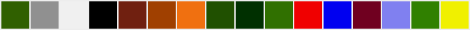

### Menu


### Pitch (Frozen)
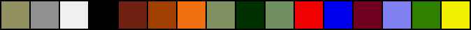

### Pitch (Muddy)
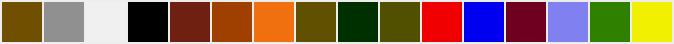

### Pitch (Wet)
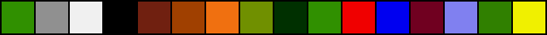

### Pitch (Soft)


### Pitch (Normal)


### Pitch (Dry)
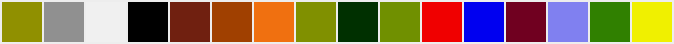

### Pitch (Hard)
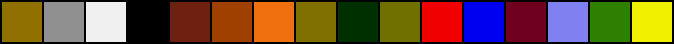

## Palettes (DOS)

For the pitch palettes each color is written to index 0, 7, 9, 78, 79, 80, 81, 106 and 107 of the Game palette respectively.

### Game
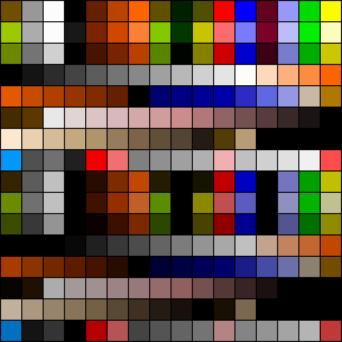

### Menu
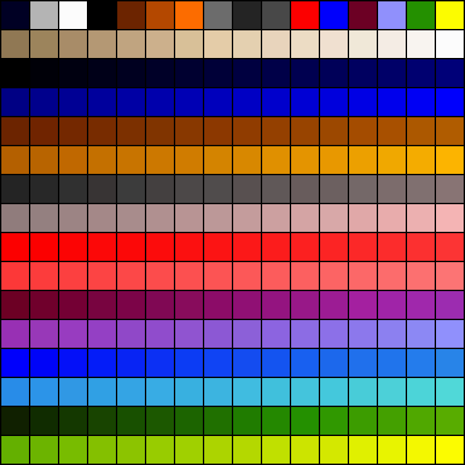

### Pitch (Frozen)


### Pitch (Muddy)
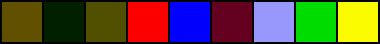

### Pitch (Wet)


### Pitch (Soft)
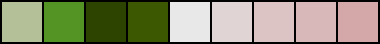

### Pitch (Normal)


### Pitch (Dry)
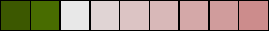

### Pitch (Hard)
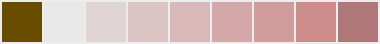


---

## Common options

```text
-amiga                    Amiga mode (default)
-dos                      DOS mode
-amiga-dir=<path>         Amiga directory (default: ./Amiga)
-dos-dir=<path>           DOS directory (default: ./DOS)

# Amiga input types
-map | -tmj | -bmp | -raw Input type (Amiga only; -json and -tmx are aliases)

-output=bmp|tmj|map|raw   Output type (Tiled maps are JSON; json/tmx are aliases)

-palette=<name>           Palette (Amiga): Soft, Muddy, Frozen, Dry, Normal, Hard, Wet
-bitplanes=N              Bitplanes 1-8 (default 4; 4=16 colors, 8=256)
-bitplanes=auto           Auto: 4bpp if image only uses colors 0-15, else 8bpp (-output=raw only)
-no-rnc                   Disable RNC compression for Amiga MAP/RAW outputs

# DOS pitch options
-pitch=N                  DOS pitch index (0..MaxPitch-1), default 0
-type=name                DOS pitch type: frozen, muddy, wet, soft, normal, dry, hard
-colors=N                 DOS: remap to N colors (16-256)
-insertblanktile          DOS pitch -output=tmj: reserve tile id 0 as a blank tile
-tilesetwidth=N           DOS pitch -output=tmj: tileset image width in pixels (default 256)

# DOS mode switches
-picture                  DOS: operate on a .256 picture file
-sprites-export           DOS: export all sprites to sprNNNN.bmp files
-sprites-import           DOS: import sprNNNN.bmp files into DAT/SPRITE.DAT
-sprite-bg=N              DOS sprites: menu palette index for background color (in BMP slot 16)
-dos2amiga                DOS: rebuild Amiga gameplay banks from DOS graphics
-jag2amiga                Jaguar: rebuild Amiga gameplay banks from a Jaguar cartridge
-jag-rom=<path>           Jaguar cartridge image (default: first ROM in ./Jag)
-jag-dir=<path>           Jaguar directory (default: ./Jag)

# General
-h, -?                    Show help
```

---

## Bitplanes (optional, default 4)

```text
4    = 16 colors
5    = 32 colors
6    = 64 colors
7    = 128 colors
8    = 256 colors
auto = 4 if the image only uses colors 0-15, otherwise 8 (-output=raw only)
```

---

## Raw formats

```text
320x256 pixels, planar, left-to-right, top-to-bottom
352x272 pixels, planar, left-to-right, top-to-bottom
```

---

## Palette export

*(no input/output files; writes multiple files to the current directory)*

```bash
swosgfx -palettes
    [-pal-color=amiga12|rgb32]                 # default: amiga12
    [-pal-file=asm|c|palette]                  # default: asm
    [-pal-count=16|128|256]                    # default: 16
    [-pal-full]                                # default: only pitch-affected colors for pitches
    [-pal-format=act|mspal|jasc|gimp|paintnet] # for -pal-file=palette, default: act
    [outDir]                                   # optional output directory
```

---

## Examples

```bash
# Render all DOS pitches as BMP, NORMAL type, remapped to 128 colors, output to ./dos-pitches
swosgfx -dos -dos-dir=DOS -output=bmp -type=normal -colors=128 dos-pitches

# Convert a DOS pitch BMP into an Amiga pitch MAP with 7 bitplanes (AGA, 128 colors)
swosgfx -amiga -bmp -output=map -bitplanes=7 dos-pitches/pitch1-normal.bmp SWCPICH1.MAP

# Convert the Amiga pitch MAP back to an AGA BMP using the selected palette
swosgfx -amiga -map -output=bmp -palette=Normal -bitplanes=7 SWCPICH1.MAP pitch1-amiga-aga.bmp

# Export all palettes (Menu + Game + all pitch types) as 256-color ACT files into the Palettes directory
swosgfx -palettes -pal-color=rgb32 -pal-file=palette -pal-count=256 -pal-full -pal-format=act Palettes
```

### More Amiga examples

```bash
# Convert an Amiga full-pitch BMP (16 colors) to .MAP using 4 bitplanes
swosgfx -amiga -bmp -output=map -bitplanes=4 fullPitch.bmp SWCPICH1.MAP

# Convert a RAW 320x256 planar dump to BMP using the "Normal" pitch palette (16 colors)
swosgfx -amiga -raw -output=bmp -palette=Normal -bitplanes=4 pitch.raw pitch-normal.bmp

# Convert a Tiled map back to Amiga .MAP (7 bitplanes for AGA)
swosgfx -amiga -tmj -output=map -bitplanes=7 pitch1-aga.tmj SWCPICH1.MAP
```

### More DOS examples

```bash
# Convert a DOS .256 picture to BMP
swosgfx -dos -picture -output=bmp TITLE.256 title-screen.bmp

# Export all DOS sprites as BMPs using menu color index 0 as the background
swosgfx -dos -sprites-export -dos-dir=DOS -sprite-bg=0 sprites-out

# Import edited sprNNNN.bmp files back into DAT/SPRITE.DAT
swosgfx -dos -sprites-import sprites-out
```

### DOS Tiled examples

```bash
# Render all DOS pitches, SOFT type, directly to Tiled .tmj maps
swosgfx -dos -dos-dir=DOS -output=tmj -type=soft -colors=128 pitches-soft-tiled

# Render all DOS pitches, DRY type, full 256 colors, directly to Tiled .tmj maps
swosgfx -dos -dos-dir=DOS -output=tmj -type=dry -colors=256 pitches-dry-256-tiled

# Render all DOS pitches, NORMAL type, with a blank tile at id 0 (Tiled2Bin -slice style)
swosgfx -dos -dos-dir=DOS -output=tmj -insertblanktile -type=normal DOS_Pitches_Tiled

# Same, but with a 32-tile-wide tileset image instead of 16
swosgfx -dos -dos-dir=DOS -output=tmj -insertblanktile -tilesetwidth=512 -type=normal DOS_Pitches_Tiled
```

### Jaguar examples

```bash
# Rebuild the Amiga banks from a Jaguar cartridge sitting in ./Jag
swosgfx -dos -dos-dir=DOS -jag2amiga Amiga_Images_256_Jag

# Same, pointing at a cartridge image somewhere else
swosgfx -dos -dos-dir=DOS -jag2amiga "-jag-rom=D:\roms\Sensible Soccer International Edition (1995).jag" Amiga_Images_256_Jag
```

### Amiga Tiled examples

```bash
# Convert an Amiga .MAP pitch (AGA, 7 bitplanes) to a Tiled .tmj map
swosgfx -amiga -map -output=tmj -palette=Normal -bitplanes=7 SWCPICH1.MAP pitch1-normal-aga.tmj

# Same, but OCS/ECS 16-color pitch using 4 bitplanes
swosgfx -amiga -map -output=tmj -palette=Soft -bitplanes=4 SWCPICH2.MAP pitch2-soft-ecs.tmj

# Take a map edited in Tiled and convert it back into an Amiga .MAP (AGA)
swosgfx -amiga -tmj -output=map -bitplanes=7 pitch1-normal-aga-edited.tmj SWCPICH1.MAP
```

---

## Credits

- [benbaker76](https://github.com/benbaker76/) - for writing the software, updating and maintaining it
- [starwindz](https://github.com/starwindz/) - author of [bmp-to-raw-for-amiga-swos](https://github.com/starwindz/bmp-to-raw-for-amiga-swos)
- [zlatkok](https://github.com/zlatkok) - author of [swpe](https://github.com/zlatkok/swos-port/tree/master/tools/swpe)
